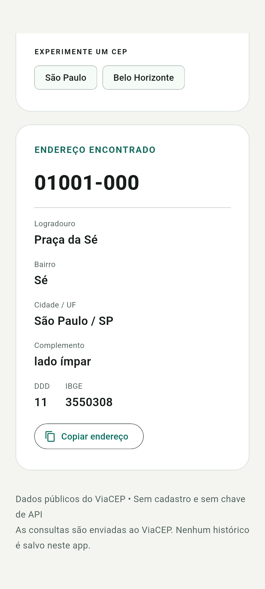

# Brazilian Postal Code Lookup

[](https://docs.flutter.dev/)
[](https://dart.dev/)
[](pubspec.yaml)
[](LICENSE)

A Flutter classroom app for looking up Brazilian postal codes through [ViaCEP](https://viacep.com.br/). It validates input, handles service failures, and presents selectable address details in a responsive Material 3 interface. No API key, Firebase project, account, or database is needed.


## Run

Install the pinned SDK through the [official Flutter instructions](https://docs.flutter.dev/install/manual), or use `fvm use 3.50.0` if you manage SDKs with FVM. An isolated tagged checkout is another reproducible option after cloning this repository:

```sh
git clone --depth 1 --branch 3.50.0 https://github.com/flutter/flutter.git ../flutter-3.50.0
export PATH="$PWD/../flutter-3.50.0/bin:$PATH"
flutter --version
```

This selects the new SDK only in the current terminal; it does not upgrade the SDK used by other projects.


Verified toolchain: Flutter **3.50.0** stable with Dart **3.14.0**, Chrome 157, and Xcode 27.2 on macOS. The manifest requires Dart >=3.14.0 <4.0.0 and Flutter >=3.50.0. The project pins Flutter 3.50.0 in `.fvmrc` and CI. Use this SDK for all commands below; Dart comes bundled with Flutter. The shared system installation is not modified by this project.

```sh
git clone https://github.com/kleberandrade/search-cep-aulas-flutter.git
cd search-cep-aulas-flutter
flutter pub get
flutter run -d chrome
```

Enter `01001-000` or `01001000`, then press Enter or **Buscar endereço**. The examples trigger a live lookup. **Limpar CEP** clears the input/result and restores keyboard focus. **Copiar endereço** copies plain address text. Results remain selectable if clipboard access is unavailable. Empty optional fields display an explicit fallback. The interface is in Brazilian Portuguese.

To try the bundled São Paulo example without contacting ViaCEP:

```sh
flutter run -d chrome --dart-define=DEMO=true
```

Demo mode is explicitly labelled and only supports `01001-000`. Other valid codes produce “not found” in this mode. The controlled sample lives in `assets/sao_paulo.json`. Without `DEMO=true`, all searches use the real service. No silent fallback or fabricated live results are used.

## Architecture and behavior

- `lib/domain/cep.dart`: validated CEP value object. Accepts eight ASCII digits or the standard five-three mask, trims surrounding whitespace, and preserves leading zeros. Letters and other punctuation are rejected.
- `lib/models/result_cep.dart`: immutable address, strict decoding at the network boundary, optional fields normalized to empty strings. Known original fields are retained in serialization, alongside current ViaCEP fields.
- `lib/services/`: injected HTTP client and explicit demo implementation behind `AddressLookup`. HTTPS, UTF-8, a ten-second timeout, typed failures, and response CEP matching. No automatic retries or API key.
- `lib/state/search_controller.dart`: idle/loading/success/error states; each search or input edit invalidates older responses. A slow request cannot overwrite newer input. Requests may finish in the background; stale responses are ignored.
- `lib/views/home_page.dart`: input, example actions, progress/error/empty states and address presentation. Native buttons and focus, live status announcements, one-column narrow layout, and two-column wide layout.
- `lib/main.dart`: theme, Portuguese localization and resource ownership; closes its client and disposes its controller.

**Glossary:** CEP is an eight-digit Brazilian postal code; address is a validated ViaCEP response; “not found” means a valid CEP whose response contains `erro`; generation is the identity of the latest user search/edit.

No lookup history or address data is persisted. Live searches send the entered CEP to ViaCEP. The app cannot guarantee external address freshness or service availability.

## Checks and builds

```sh
dart format --output=none --set-exit-if-changed lib test tool integration_test test_driver
flutter analyze
flutter test --coverage
flutter build web
# Optional integration check: contacts the actual external service
dart run tool/smoke.dart
# Native builds require the corresponding local toolchain
flutter build macos
flutter build ios --no-codesign
flutter build apk --debug
flutter build apk --release
```

The deterministic suite covers normalization, model serialization, valid responses, nonexistent CEP, HTTP/JSON/schema failures, response mismatch, network failure, timeout, rapid searches, edited input, disposal, local examples, and widget states/retry. Layout tests include a narrow viewport with 200% text. `http/testing.dart` and fixtures are used only in tests. The optional smoke script is a separate real ViaCEP request, excluded from CI to avoid external-service flakiness.

The workflow `.github/workflows/flutter.yml` runs formatting, analysis, tests, Web build and a separate Android release APK build with JDK 21 on `master` pushes and pull requests. Version badges identify the tested SDK, not a fabricated CI or coverage result. See [validation and action log](docs/modernization-log.md) for actual outcomes and platform limitations.

### Android validation — app 2.0.2+4

Debug and release APK builds passed locally. The release app was installed and launched on **Android 16 / API 36**, using the dedicated **Search_CEP_API_36** emulator (Google APIs, ARM64, Pixel 7 profile). Package metadata confirmed versionName `2.0.2`, versionCode `4`, minSdk `24` and targetSdk `36`.

The optional device test below passed in **debug mode** with the actual ViaCEP service and Android clipboard. It is **one end-to-end test with six checks**: initial state, invalid input, UTF-8 address lookup (`01001-000`), clipboard contents, clear, and a real nonexistent CEP (`00000000`). It is separate from the **21 deterministic unit/widget tests**, which also passed with clean analysis. Four native Flutter-surface captures are in [docs/screenshots](docs/screenshots); the address is shown below.

```sh
flutter devices
# Replace the ID with your running Android emulator/device
flutter drive --driver=test_driver/android_live_driver.dart --target=integration_test/android_live_test.dart -d emulator-5554
```

The driver saves actual device PNGs and a result report at `build/android-live-result.json`. The live test is excluded from CI because it depends on ViaCEP/network availability; CI builds the release APK. This was an emulator check, not a physical-phone test or performance measurement. Release signing still uses the classroom debug key and is not configured for Google Play distribution.



For an existing Web build preview:

```sh
python3 -m http.server 8766 --bind 127.0.0.1 --directory build/web
```

Open `http://127.0.0.1:8766`. A production host must serve the generated `build/web` folder over HTTPS. No deployment is configured by this project.

## Migration from the 2019 classroom version

Dart 2 nullable mutable fields were replaced with Dart 3 null-safe immutable boundary parsing. The current Flutter 3.50 migration uses the official standalone `material_ui` 1.11.1 package and its localization delegates, replacing the deprecated `package:flutter/material.dart` imports. `flutter_localizations` is now transitive rather than an application dependency. `RaisedButton` was replaced with Material 3 buttons, raw JSON output with address fields, and static `fetchCep` with an injected service: `ViaCepService(client).lookup(Cep.parse(input))`. The HTTP client belongs to the caller, which must close it. Code using the old internal Dart API must adopt this call; this application is not a published package.

Android follows the Flutter 3.50 template: Gradle 9.5.0, AGP 9.3.1, registered Kotlin Gradle plugin 2.4.20, JDK 21 for builds and Java/Kotlin 17 targets. compileSdk/targetSdk are 36, minSdk is 24 and the selected NDK is 28.2.13676358. The Flutter migrator adds `android.builtInKotlin=false` and `android.newDsl=false` compatibility flags; this is not a claim of a completed built-in Kotlin migration. The former Gradle 8.14 setup failed the SDK minimum-version check and was replaced rather than bypassing validation. INTERNET permission is present in the release manifest. Android retains `com.example.search_cep` and iOS retains `com.example.searchCep`; configure signing and a production identifier before distributing your own app. Local SDK paths and generated registrants are no longer tracked.

App version **2.0.2+4** retains exact `dependency_overrides` for `material_color_utilities: 0.13.1` and `test_api: 0.7.15`. The official Flutter 3.50 SDK otherwise pins 0.13.0 and 0.7.14 respectively. Both overrides were first tested locally, then promoted after clean analysis, all 21 tests, Web/macOS release/iOS unsigned builds and real Web interaction checks. They bypass the upstream constraints; this records compatibility observed for this app and toolchain, not an upstream guarantee for future SDKs. The SDK source was not edited.

All nine previously outdated transitives are now at the latest versions checked for this release. `docs/dependencies-flutter-3.50.json` is the resolver report with overrides; `docs/dependencies-without-overrides.json` shows the remaining upstream constraints without them. Compare with:

```sh
flutter pub outdated
flutter pub outdated --no-dependency-overrides
```

Keep the overrides exact and retain the lockfile. Re-run the checks and inspect the UI whenever upgrading the SDK or override versions. Remove an override once upstream constraints permit the tested version, then resolve and validate again. Temporary local experiments in `pubspec_overrides.yaml` are ignored by Git; shared decisions belong in `pubspec.yaml`.

The iOS runner uses the modern Flutter scene lifecycle; its minimum target is iOS 15. macOS minimum is 12 to match the available Xcode toolchain. Web and macOS runners were added from the installed Flutter templates. Original iOS artwork and MIT attribution are preserved. Doctor still warns that some Android licenses are pending, but the components used for these APK builds and this emulator worked without new license acceptance. No terms were accepted by the agent; developers must personally review any terms requested by their own installation. No persistent store existed before or after this migration, so no data migration is needed.

## Classroom material and credits

Original tutorial by **Kleber de Oliveira Andrade**: [Consultando CEPs com Flutter](https://medium.com/flutter-comunidade-br/consultando-ceps-com-flutter-a395b86ce34a), originally linked as [bit.ly/2kcGFQh](http://bit.ly/2kcGFQh). The original article was updated and republished in Portuguese on 2026-11-17, preserving its URL, title and authorship. It now includes a new cover, actual Web and Android screenshots with captions/alternative text, progressive explanations, current source excerpts, checkpoints and exercises. See the [published teaching source and assets](docs/medium/README.md) and the [technical reference](docs/medium-update.pt-BR.md).

The original [form validation article by @nitishk72](https://medium.com/@nitishk72/form-validation-in-flutter-d762fbc9212c) remains a third-party historical reference. It was not edited. Useful original learning references: [themes](https://docs.flutter.dev/cookbook/design/themes), [forms](https://docs.flutter.dev/cookbook/forms), [async exceptions video](https://www.youtube.com/watch?v=qAzxZJ8NRwI), [Panache theme editor](https://rxlabz.github.io/panache/).

The article ends with exactly five app-improvement challenges and acceptance criteria, after its credits and references. Input validation and error handling are now implemented. Native status widgets and SnackBar replace the old Flushbar suggestion; the old `dynamic_theme` and `share` package suggestions are historical, not dependencies of this version.

MIT — Copyright 2019 Kleber de Oliveira Andrade. See [LICENSE](LICENSE). Flutter-generated platform assets and Material icons are used under their respective upstream licenses; no third-party article or image was relicensed. Screenshots in `docs/screenshots` show the real running app and repository metadata, not design mockups.
